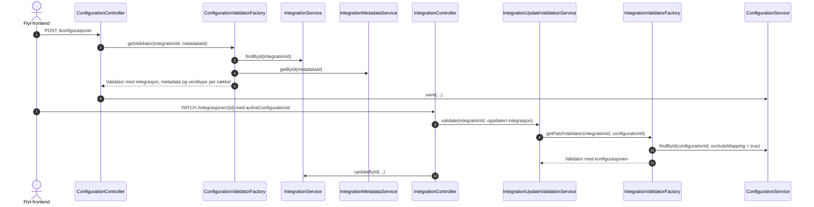
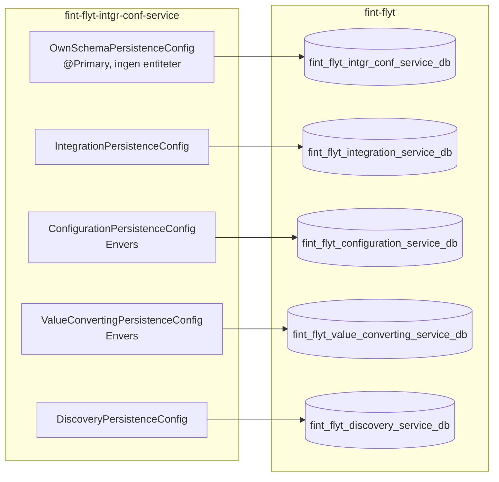

# C4 nivå 3: Komponenter

Komponentene i `fint-flyt-intgr-conf-service`. Hvert domene er en egen pakke under
`no.novari.flyt.catalog` med egen persistence unit, egen feilhåndterer og egen OpenAPI-gruppe.

## Diagram

```mermaid
%%{init: {"c4": {"c4ShapeMargin": 120}}}%%
C4Component
    title Komponenter i fint-flyt-intgr-conf-service

    System_Ext(frontend, "Flyt-frontend", "Internt API")
    System_Ext(gateways, "Instans-gateways", "Publiserer metadata, slår opp integrasjoner")
    ContainerQueue_Ext(kafka, "Kafka", "Delt Kafka-klynge", "{tenant}.flyt.*")
    System_Ext(mapping, "mapping-service", "Henter konfigurasjon, mapping og verdikonverteringer")
    Component(valueconverting, "Value-converting", "catalog.valueconverting", "Verdikonverteringer og historikk")
    Component(integration, "Integration", "catalog.integration", "Integrasjoner og aktivering av konfigurasjon")
    Component(configuration, "Configuration", "catalog.configuration", "Konfigurasjoner, mappingtrær og historikk")
    Component(discovery, "Discovery", "catalog.discovery", "Integrasjons- og instansmetadata")
    ContainerDb(db, "fint-flyt", "PostgreSQL", "Ett skjema per domene")
    Component(persistence, "Persistens", "catalog.database", "DataSource, EntityManagerFactory og Flyway per skjema")
    Component(security, "Sikkerhet", "flyt-web-resource-server", "JWT-validering og tilgang per kildeapplikasjon")
    System_Ext(authorization, "authorization-service", "Tilgang og visningsnavn")

    Rel(frontend, valueconverting, "HTTPS")
    Rel(frontend, integration, "HTTPS")
    Rel(frontend, configuration, "HTTPS")
    Rel(gateways, discovery, "POST /metadata", "HTTPS")
    Rel(mapping, kafka, "Oppslag")
    Rel(gateways, kafka, "Oppslag og hendelser")
    Rel(valueconverting, kafka, "Svarer")
    Rel(integration, kafka, "Svarer")
    Rel(configuration, kafka, "Svarer")
    Rel(kafka, discovery, "Metadatahendelser")
    Rel(integration, configuration, "Henter konfigurasjon")
    Rel(configuration, integration, "Henter integrasjon")
    Rel(configuration, discovery, "Henter metadata")
    Rel(persistence, db, "JDBC")
    Rel(security, authorization, "HTTPS, Kafka")

    UpdateRelStyle(frontend, valueconverting, $textColor="#3B82F6", $lineColor="#3B82F6")
    UpdateRelStyle(frontend, integration, $textColor="#3B82F6", $lineColor="#3B82F6", $offsetX="-40")
    UpdateRelStyle(frontend, configuration, $textColor="#3B82F6", $lineColor="#3B82F6", $offsetX="40", $offsetY="20")
    UpdateRelStyle(gateways, discovery, $textColor="#3B82F6", $lineColor="#3B82F6", $offsetX="80", $offsetY="20")
    UpdateRelStyle(mapping, kafka, $textColor="#3B82F6", $lineColor="#3B82F6", $offsetY="-20")
    UpdateRelStyle(gateways, kafka, $textColor="#3B82F6", $lineColor="#3B82F6", $offsetY="-20")
    UpdateRelStyle(valueconverting, kafka, $textColor="#3B82F6", $lineColor="#3B82F6", $offsetX="-80", $offsetY="-30")
    UpdateRelStyle(integration, kafka, $textColor="#3B82F6", $lineColor="#3B82F6", $offsetX="-20")
    UpdateRelStyle(configuration, kafka, $textColor="#3B82F6", $lineColor="#3B82F6", $offsetX="-40", $offsetY="-20")
    UpdateRelStyle(kafka, discovery, $textColor="#3B82F6", $lineColor="#3B82F6", $offsetX="30")
    UpdateRelStyle(integration, configuration, $textColor="#3B82F6", $lineColor="#3B82F6", $offsetY="-30")
    UpdateRelStyle(configuration, integration, $textColor="#3B82F6", $lineColor="#3B82F6", $offsetY="20")
    UpdateRelStyle(configuration, discovery, $textColor="#3B82F6", $lineColor="#3B82F6", $offsetY="-30")
    UpdateRelStyle(persistence, db, $textColor="#3B82F6", $lineColor="#3B82F6", $offsetY="-20")
    UpdateRelStyle(security, authorization, $textColor="#3B82F6", $lineColor="#3B82F6", $offsetY="-20")
    UpdateLayoutConfig($c4ShapeInRow="4", $c4BoundaryInRow="1")
```

Blå bokser er komponenter i applikasjonen, grå er eksterne. Diagrammet viser komponentene med
kontakt utenfor applikasjonen. Alle fire domenene går gjennom Persistens og Sikkerhet, og Validering
og Audit brukes av flere domener. De er beskrevet under [Tverrgående](#tverrgående).

## Oppslag mellom domenene

Domenene kaller hverandres tjenesteklasser direkte og bruker hverandres DTO-er. Ingen av
oppslagene går over nettverket.

Mangler integrasjonen, metadataen eller instansmetadataen, avvises konfigurasjonen med en egen
feil for hver av dem. Aktiveringen avvises hvis konfigurasjonen ikke finnes, ikke er fullført eller
hører til en annen integrasjon.

## Integration

Pakke: [`no.novari.flyt.catalog.integration`](../../src/main/kotlin/no/novari/flyt/catalog/integration)

Integrasjonene: hvilken kildeapplikasjon og integrasjons-ID de gjelder, destinasjonen, om de er
aktive og hvilken konfigurasjon som er aktiv.

| Klasse                                                    | Ansvar                                                              |
|-----------------------------------------------------------|---------------------------------------------------------------------|
| `api.IntegrationController`                               | `/api/intern/integrasjoner`, med tilgangssjekk per kildeapplikasjon |
| `application.IntegrationService`                          | Oppslag, opprettelse og oppdatering                                 |
| `application.IntegrationUpdateValidationService`          | Validerer en endring før den lagres                                 |
| `validation.IntegrationValidatorFactory`                  | Bygger validatoren med konfigurasjonen fra Configuration            |
| `kafka.IntegrationRequestConsumerConfiguration`           | Oppslag på kildeapplikasjon og kildeapplikasjonens integrasjons-ID  |
| `kafka.ActiveConfigurationIdRequestConsumerConfiguration` | Aktiv konfigurasjon for en integrasjon                              |
| `persistence.IntegrationRepository`                       | Spring Data-repository mot integration-skjemaet                     |
| `web.GlobalExceptionHandler`                              | Problem Details for `IntegrationController`                         |

Persistence uniten har Hibernates bean-validering ved lagring slått av. Valideringen skjer i
API-laget: med `@Valid` ved opprettelse og i `IntegrationUpdateValidationService` ved endring.

## Configuration

Pakke: [`no.novari.flyt.catalog.configuration`](../../src/main/kotlin/no/novari/flyt/catalog/configuration)

Konfigurasjonene: hvilken integrasjon og metadataversjon de gjelder, om de er fullført, og
mappingtreet fra instansfelter til destinasjonens felter.

| Klasse                                            | Ansvar                                                                      |
|---------------------------------------------------|-----------------------------------------------------------------------------|
| `ConfigurationController`                         | `/api/intern/konfigurasjoner`                                               |
| `ConfigurationHistoryController`                  | `/history` og `/{id}/history`                                               |
| `ConfigurationService`                            | Oppslag, lagring med versjonering, oppdatering og sletting                  |
| `ConfigurationHistoryService`                     | Envers-historikk                                                            |
| `mapping.*`                                       | Mapping mellom entiteter og DTO-er for hele mappingtreet                    |
| `validation.ConfigurationValidatorFactory`        | Bygger validatoren med integrasjon og metadata fra Integration og Discovery |
| `validation.ValidatorConfiguration`               | Domenets egen `ValidatorFactory`, `configurationHibernateValidatorFactory`  |
| `validation.constraints.*`                        | Regler for mappingtreet, nøkler og verdityper                               |
| `kafka.ConfigurationRequestConsumerConfiguration` | Mappingtreet for en konfigurasjon                                           |
| `ApiExceptionHandler`                             | Feilsvar for de to kontrollerne                                             |

Domenets `ValidatorFactory` brukes både av `ConfigurationValidatorFactory` og av Hibernate ved
lagring i configuration sin persistence unit. MVC-valideringen og de andre domenene bruker Spring
Boots `defaultValidator`.

Endepunktene sjekker roller på det interne API-et, men ikke tilgang per kildeapplikasjon.

## Value-converting

Pakke: [`no.novari.flyt.catalog.valueconverting`](../../src/main/kotlin/no/novari/flyt/catalog/valueconverting)

Verdikonverteringene: tabeller som oversetter verdier fra kildeapplikasjonen til verdier
destinasjonen forstår.

| Klasse                                                                 | Ansvar                                                        |
|------------------------------------------------------------------------|---------------------------------------------------------------|
| `api.ValueConversionController`                                        | `/api/intern/value-convertings`, med filtrering og paginering |
| `api.ValueConversionHistoryController`                                 | `/history` og `/{id}/history`                                 |
| `application.ValueConversionService`                                   | Oppslag, opprettelse, erstatning og sletting                  |
| `domain.ValueConversionHistoryService`                                 | Envers-historikk                                              |
| `infrastructure.messaging.ValueConversionRequestConsumerConfiguration` | Verdikonvertering på ID                                       |
| `infrastructure.persistence.ValueConversionRepository`                 | Spring Data-repository med spesifikasjoner for filtrering     |
| `api.ValueConversionExceptionHandler`                                  | Problem Details for de to kontrollerne                        |

## Discovery

Pakke: [`no.novari.flyt.catalog.discovery`](../../src/main/kotlin/no/novari/flyt/catalog/discovery)

Metadataen kildeapplikasjonene publiserer: én versjon per endring av en integrasjon, med
instansmetadata som beskriver feltene, kategoriene og objektsamlingene i en instans.

| Klasse                                                | Ansvar                                            |
|-------------------------------------------------------|---------------------------------------------------|
| `IntegrationMetadataController`                       | `/api/intern/metadata`                            |
| `IntegrationMetadataService`                          | Oppslag og lagring av metadataversjoner           |
| `kafka.IntegrationMetadataEventConsumerConfiguration` | Konsumerer `event.integration-metadata-received`  |
| `kafka.IntegrationMetadataEventHandler`               | Lagrer en ny versjon hvis den ikke finnes fra før |
| `mapping.*`                                           | Mapping mellom entiteter og DTO-er                |
| `IntegrationMetadataRequestExceptionHandler`          | Feilsvar for `IntegrationMetadataController`      |

Lagringen fra hendelsene er idempotent: `IntegrationMetadataEventHandler` sjekker om versjonen
finnes, og databasen har en unik constraint på kildeapplikasjon, integrasjons-ID og versjon.

## Persistens

Pakke: [`no.novari.flyt.catalog.database`](../../src/main/kotlin/no/novari/flyt/catalog/database),
pluss `<Domene>PersistenceConfig` i hver domenepakke.

Hvert domene har sin egen `DataSource`, `EntityManagerFactory`, `PlatformTransactionManager` og
`Flyway`. Fem persistence units er nødvendig fordi `configuration_aud` og `value_converting_aud`
har fremmednøkkel til hver sin `revinfo`, og Envers tillater én revisjonsentitet per persistence
unit.

Primærkandidaten peker på tjenestens eget, tomme skjema. En `@Transactional`, `EntityManager` eller
et repository uten qualifier feiler dermed på manglende tabell i stedet for å treffe et
domeneskjema. `TransactionManagerBindingTest` sjekker at hver `@Transactional` i et domene navngir
domenets transaksjonsmanager.

## Tverrgående

| Komponent  | Hvor                                                                            | Innhold                                                                        |
|------------|---------------------------------------------------------------------------------|--------------------------------------------------------------------------------|
| Validering | [`catalog.validation`](../../src/main/kotlin/no/novari/flyt/catalog/validation) | `ValidationErrorsFormattingService` og `HibernateConstraintValidator`          |
| OpenAPI    | [`catalog.openapi`](../../src/main/kotlin/no/novari/flyt/catalog/openapi)       | Felles OpenAPI-oppsett. Hvert domene har sin egen gruppe i `<domene>.openapi`. |
| Sikkerhet  | `flyt-web-resource-server`                                                      | JWT-validering, roller per organisasjon og `UserAuthorizationService`          |
| Audit      | `flyt-audit-starter`                                                            | Auditkolonner, Envers-historikk og visningsnavn for aktører                    |
| Kafka      | `flyt-kafka`                                                                    | Request/reply-maler, topic-navn og feilhåndtering for konsumentene             |

`@SpringBootApplication` skanner `no.novari.flyt.catalog`, `no.novari.flyt.webresourceserver` og
`no.novari.kafka`, fordi bibliotekene registrerer deler av bønnene sine som `@Service`-klasser.

## Videre lesning

- [Systemkontekst](c4-context.md)
- [Containere](c4-container.md)
