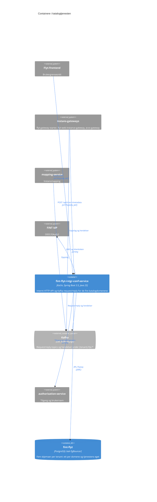

# C4 nivå 2: Containere

Katalogtjenesten består av én applikasjon og én database. Kafka er en delt plattformtjeneste.

## Diagram

Blå bokser er en del av katalogtjenesten, grå er eksterne.

## fint-flyt-intgr-conf-service

Spring Boot-applikasjon som samler de fire katalogdomenene. Den bygges til et distroless
Java 25-image og rulles ut som en Flaiserator-`Application` i namespacet til hver tenant.

| Egenskap  | Verdi                                                                                           |
|-----------|-------------------------------------------------------------------------------------------------|
| Teknologi | Kotlin, Spring Boot 3.5, Spring Data JPA, Hibernate Envers, Flyway, springdoc                   |
| Utrulling | Kubernetes via Flaiserator, én instans per tenant i beta og i produksjon                        |
| Ressurser | 2048Mi minnetak, `-Xmx1536M`, 500m CPU-tak, 150m CPU-forespørsel                                |
| Kontekst  | `server.servlet.context-path` er `/{tenant}` i produksjon og `/beta/{tenant}` i beta            |
| Helse     | `/actuator/health`, `/actuator/health/readiness`, `/actuator/health/liveness`                   |
| Metrikker | `/actuator/prometheus`                                                                          |
| Konfig    | [kustomize/base/flais.yaml](../../kustomize/base/flais.yaml) og ett overlay per tenant og miljø |

### HTTP-API

Alt ligger under `/api/intern` og krever JWT fra FINT IdP. Hvilke organisasjoner og roller som
slipper inn, settes per tenant i overlayet. Swagger UI og OpenAPI-spesifikasjonen ligger utenfor
ingress-rutene og nås bare med port-forward, se [README](../../README.md#openapi-dokumentasjon).

| Ressurs                         | Operasjoner                                                                                          |
|---------------------------------|------------------------------------------------------------------------------------------------------|
| `/api/intern/integrasjoner`     | `GET` liste, også paginert, `GET /{id}`, `POST`, `PATCH /{id}`                                       |
| `/api/intern/konfigurasjoner`   | `GET` liste, `GET /{id}`, `POST`, `PATCH /{id}`, `DELETE /{id}`, `GET /history`, `GET /{id}/history` |
| `/api/intern/value-convertings` | `GET` liste, `GET /{id}`, `POST`, `PUT /{id}`, `DELETE /{id}`, `GET /history`, `GET /{id}/history`   |
| `/api/intern/metadata`          | Fire `GET`-varianter på kildeapplikasjon, `GET /{id}/instans-metadata`, `POST`                       |

Hver ressurs har sin egen ingress-rute.

### Kafka

Topic-navnene bygges som `{tenant}.flyt.{type}.{ressurs}.by.{parameter}`. Svar går på
`{tenant}.flyt.reply.{klientens applikasjons-ID}.{ressurs}`, så klientene eier sine svar-topics.

| Topic                                                                                | Rolle      | Motpart               |
|--------------------------------------------------------------------------------------|------------|-----------------------|
| `request.value-converting.by.value-converting-id`                                    | Svarer     | mapping-service       |
| `request.integration.by.source-application-id-and-source-application-integration-id` | Svarer     | Instans-gateways      |
| `request.active-configuration-id.by.integration-id`                                  | Svarer     | mapping-service       |
| `request.mapping.by.configuration-id`                                                | Svarer     | mapping-service       |
| `event.integration-metadata-received`                                                | Konsumerer | Instans-gateways      |
| `request.authorization.by.client-id`                                                 | Spør       | authorization-service |

Consumer group er applikasjonsnavnet, med `auto.offset.reset=earliest`. Request/reply-konsumentene
er rene lesninger. Metadatahendelsen er den eneste som skriver, og den er idempotent i to lag: en
`exists`-sjekk i applikasjonen og en unik constraint på kildeapplikasjon, integrasjons-ID og
versjon.

## fint-flyt-database

PostgreSQL-databasen `fint-flyt`, felles for Flyt-tjenestene i en tenant. Katalogtjenesten bruker
fem skjemaer med felles tenant-prefiks:

| Skjema                                  | Innhold                                                      |
|-----------------------------------------|--------------------------------------------------------------|
| `fint_flyt_integration_service_db`      | Integrasjoner                                                |
| `fint_flyt_configuration_service_db`    | Konfigurasjoner, mappingtrær, Envers-revisjoner og `revinfo` |
| `fint_flyt_value_converting_service_db` | Verdikonverteringer, Envers-revisjoner og `revinfo`          |
| `fint_flyt_discovery_service_db`        | Integrasjonsmetadata og instansmetadata                      |
| `fint_flyt_intgr_conf_service_db`       | Tjenestens eget skjema, tomt                                 |

Databasebrukeren opprettes av Flaiserator etter applikasjonsnavnet, og prefikset utledes fra den.
Databasen nås gjennom PgBouncer i transaksjonsmodus, så Hibernate kvalifiserer alle tabellnavn
med skjemaet i stedet for å stole på `search_path`.

Hvert domeneskjema har sin egen Flyway-historikk. Flyway validerer ved oppstart, og
migreringsfilene må ikke endres. Se [README](../../README.md#flyway).

## Bygg og utrulling

| Workflow                                      | Når                                       | Hva                                                         |
|-----------------------------------------------|-------------------------------------------|-------------------------------------------------------------|
| [CI](../../.github/workflows/CI.yaml)         | Pull request og push til `main`           | Bygger imaget, og publiserer det ved push til `main`        |
| [CD](../../.github/workflows/CD.yaml)         | Når CI-bygget er ferdig                   | Utrulling til alle tenants i begge klyngene                 |
| [MD](../../.github/workflows/MD.yaml)         | Manuelt                                   | Bygg og utrulling av valgt branch til én tenant i én klynge |
| [CodeQL](../../.github/workflows/codeql.yaml) | Pull request, push til `main` og ukentlig | Statisk sikkerhetsanalyse                                   |

Beta kjører i `aks-beta-fint-2021-11-23` og produksjon i `aks-api-fint-2022-02-08`.

## Videre lesning

- [Systemkontekst](c4-context.md)
- [Komponenter](c4-component.md)
