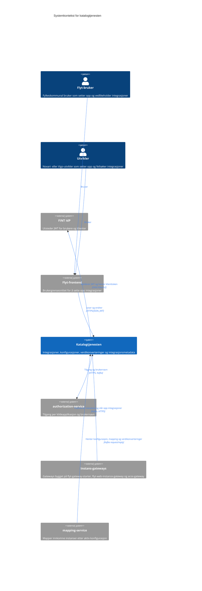

# C4 nivå 1: Systemkontekst

Katalogtjenesten eier katalogen over hva FINT Flyt skal ta imot og hvordan det skal leveres:
integrasjonene, konfigurasjonene som beskriver mappingen, verdikonverteringene og metadataen
kildeapplikasjonene publiserer om sine integrasjoner.

Tjenesten kjører én instans per tenant og miljø. Diagrammet viser én slik instans.

## Diagram

Blå boks er katalogtjenesten, grå er eksterne systemer.

## Brukere

| Bruker      | Type   | Behov                                                                                          |
|-------------|--------|------------------------------------------------------------------------------------------------|
| Flyt-bruker | Person | Opprette og aktivere integrasjoner, bygge konfigurasjoner og vedlikeholde verdikonverteringer. |
| Utvikler    | Person | Sette opp og feilsøke integrasjoner på vegne av fylkene.                                       |

Begge ser bare kildeapplikasjonene authorization-service gir dem tilgang til. Hvilke organisasjoner
og roller som slipper inn, settes i overlayet for hver tenant.

## Eksterne systemer

| System                | Retning | Integrasjon         | Hva det brukes til                                                                                    |
|-----------------------|---------|---------------------|-------------------------------------------------------------------------------------------------------|
| Flyt-frontend         | Inn     | HTTPS/JSON          | Det interne API-et under `/api/intern`.                                                               |
| Instans-gateways      | Inn     | Kafka, HTTPS        | Publiserer integrasjonsmetadata og slår opp integrasjonen for en innkommende instans.                 |
| mapping-service       | Inn     | Kafka request/reply | Henter aktiv konfigurasjon for en integrasjon, mappingen for en konfigurasjon og verdikonverteringer. |
| authorization-service | Ut      | HTTPS, Kafka        | Hvilke kildeapplikasjoner en bruker har tilgang til, visningsnavn for aktører og klientautorisasjon.  |
| FINT IdP              | Ut      | OIDC/OAuth2         | Validering av innkomne JWT og client credentials mot authorization-service.                           |

Kafka og PostgreSQL er plattformtjenester og vises på containernivå.

## Sentrale flyter

### Sette opp en integrasjon

1. En kildeapplikasjon publiserer metadata om integrasjonen sin, enten som hendelse på Kafka eller
   med `POST /api/intern/metadata`.
2. Brukeren oppretter integrasjonen i Flyt-frontend (`POST /api/intern/integrasjoner`).
3. Brukeren bygger en konfigurasjon mot en metadataversjon (`POST /api/intern/konfigurasjoner`).
   Katalogen validerer at integrasjonen og metadataen hører sammen, og at mappingen bare refererer
   til felter metadataen har.
4. Brukeren aktiverer integrasjonen med konfigurasjonen (`PATCH /api/intern/integrasjoner/{id}`).
   Katalogen avviser aktiveringen hvis konfigurasjonen ikke er fullført eller hører til en annen
   integrasjon.

### Ta imot en instans

1. En gateway mottar en instans og slår opp integrasjonen på kildeapplikasjon og
   kildeapplikasjonens integrasjons-ID over Kafka.
2. mapping-service henter aktiv konfigurasjon, mappingen og eventuelle verdikonverteringer over
   Kafka, og mapper instansen.

## Videre lesning

- [Containere](c4-container.md)
- [Komponenter](c4-component.md)
